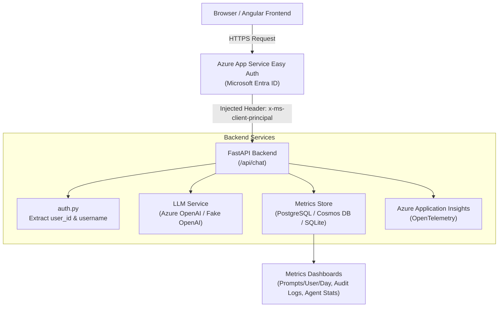

# AI Prompt Metrics & Production Implementation Guide

This guide details how prompt metrics are collected using **Azure App Service Easy Auth**, how the current implementation works, and the architecture, databases, and practices required to run this solution at scale in **production**.

---

## 1. High-Level Architecture

In this system, Azure App Service handles identity verification at the platform boundary. The FastAPI backend extracts identity metadata from Easy Auth headers, passes prompts to the LLM engine, and records full execution telemetry into a metrics store.



---

## 2. Telemetry & Metrics Collected

Every prompt submission to `/api/chat` records the following data points:

| Dimension / Metric | Field Name | Description | Source |
|---|---|---|---|
| **User ID** | `user_id` | Unique object ID / Entra ID principal ID | Easy Auth (`x-ms-client-principal`) |
| **Username** | `user_name` | User's work email or UPN | Easy Auth (`preferred_username`) |
| **Agent ID** | `agent_id` | Identifier of the assistant persona | Request payload |
| **Agent Name** | `agent_name` | Friendly name of the agent | Agent Catalog |
| **Model** | `model` | AI model deployed (e.g. `gpt-4o`, `gpt-35-turbo`) | Agent / LLM configuration |
| **Input Prompt** | `prompt_input` | Full prompt text submitted by user | Request payload |
| **LLM Response** | `prompt_response` | Text response returned by the model | LLM completion output |
| **Input Tokens** | `input_tokens` | Prompt token count | LLM usage response |
| **Output Tokens** | `output_tokens` | Completion token count | LLM usage response |
| **Total Tokens** | `total_tokens` | Total tokens consumed (`input + output`) | LLM usage response |
| **Latency** | `latency_ms` | Request turnaround time in milliseconds | Backend execution timer |
| **Timestamp** | `created_at` | Precise UTC ISO-8601 timestamp | Backend |
| **Date** | `date` | `YYYY-MM-DD` index for fast aggregation | Backend |

---

## 3. How Easy Auth Captures User Identity

When a request passes through Azure App Service with authentication enabled:

1. Azure injects the `x-ms-client-principal` header containing a base64-encoded JSON structure:
   ```json
   {
     "auth_typ": "aad",
     "claims": [
       {"typ": "http://schemas.xmlsoap.org/ws/2005/05/identity/claims/nameidentifier", "val": "oid-user-4567"},
       {"typ": "name", "val": "Jane Doe"},
       {"typ": "preferred_username", "val": "jane.doe@contoso.com"}
     ],
     "userId": "oid-user-4567",
     "userRoles": ["authenticated", "Reader"]
   }
   ```
2. In [backend/app/auth.py](file:///home/yoga/pc_projects/aa-account/Authorization-chatgpt/azure-easyauth-angular-fastapi/backend/app/auth.py), the `get_current_user` dependency parses this header:
   ```python
   def get_current_user(principal: dict[str, Any] = Depends(get_principal)) -> dict[str, Any]:
       return safe_user_summary(principal)
       # Returns: {"user_id": "oid-user-4567", "username": "jane.doe@contoso.com", ...}
   ```
3. **No credentials or passwords are ever stored** in your application database. User tracking is anchored directly to the enterprise identity provider.

---

## 4. Current Starter vs. Production Architecture

| Component | Starter Implementation (Current) | Production Recommendation | Why the Change is Necessary |
|---|---|---|---|
| **Database** | SQLite (`metrics.db`) | **Azure Cosmos DB** (NoSQL) or **Azure Database for PostgreSQL (Flexible Server)** | Azure App Service uses SMB network shares for `/home`. SQLite file locking over SMB causes concurrency issues when scaling out to multiple instances. |
| **LLM Provider** | `FakeOpenAIService` (in-memory simulator) | **Azure OpenAI Service** via `AzureOpenAI` SDK | Real model inference, enterprise SLAs, private virtual networks, content filtering. |
| **LLM Auth** | Dummy / None | **Azure Managed Identity** (`DefaultAzureCredential`) | Passwordless authentication; zero secret keys stored in environment variables or code. |
| **Observability** | REST Endpoints + Local SQLite queries | **Azure Monitor & Application Insights** | Distributed tracing across microservices, SLA monitoring, threshold alerting. |
| **Privacy / PII** | Raw prompt input and response saved | **PII Masking / Redaction Pipeline** | Prevents logging credit cards, credentials, SSNs, or sensitive customer data into audit logs. |
| **Rate Limiting** | Open | **Token & Prompt Quotas per User/Day** | Prevents denial-of-wallet and quota exhaustion by individual users. |

---

## 5. What to Use in Production

### 5.1. Database: Azure Cosmos DB or Azure Database for PostgreSQL

#### Option A: Azure Cosmos DB (NoSQL API) &mdash; *Recommended for LLM Prompts*
- **Why**: Prompt inputs and LLM responses vary greatly in length, structure, and metadata (e.g. tool calls, citations). Cosmos DB is a schema-agnostic document database with millisecond latency at any scale.
- **Partition Key**: Partition by `/user_id` or `/date` for rapid query performance.
- **Built-in TTL (Time-to-Live)**: Automatically purge detailed prompt responses after 30 or 90 days for compliance without maintenance jobs.

```python
# Example Cosmos DB prompt logger
from azure.cosmos.aio import CosmosClient
from azure.identity.aio import DefaultAzureCredential

async def log_prompt_to_cosmos(container, prompt_record: dict):
    # prompt_record contains id, user_id, date, prompt_input, prompt_response, etc.
    # Set TTL to 90 days (7,776,000 seconds)
    prompt_record["ttl"] = 7776000
    await container.upsert_item(prompt_record)
```

#### Option B: Azure Database for PostgreSQL (Flexible Server)
- **Why**: If you require strict relational queries, complex SQL joins, or existing enterprise BI integration (e.g. PowerBI).
- **Setup**: Use connection pooling (`pgbouncer` or `asyncpg` pool) and store prompt data using `JSONB` for flexibility.

---

### 5.2. LLM Engine: Azure OpenAI with Managed Identity

In production, replace `FakeOpenAIService` with Azure OpenAI. **Do not use static API keys**. Use Azure Managed Identity for zero-secret credential management:

```python
# production_llm.py
import os
import time
from azure.identity import DefaultAzureCredential, get_bearer_token_provider
from openai import AzureOpenAI

token_provider = get_bearer_token_provider(
    DefaultAzureCredential(),
    "https://cognitiveservices.azure.com/.default"
)

client = AzureOpenAI(
    azure_endpoint=os.environ["AZURE_OPENAI_ENDPOINT"],
    azure_ad_token_provider=token_provider,
    api_version="2024-06-01",
)

def run_prompt_production(messages: list[dict], model: str = "gpt-4o"):
    start = time.perf_counter()
    response = client.chat.completions.create(
        model=model,
        messages=messages,
    )
    latency_ms = round((time.perf_counter() - start) * 1000, 2)
    
    return {
        "id": response.id,
        "content": response.choices[0].message.content,
        "prompt_tokens": response.usage.prompt_tokens,
        "completion_tokens": response.usage.completion_tokens,
        "total_tokens": response.usage.total_tokens,
        "latency_ms": latency_ms,
    }
```

> [!IMPORTANT]
> In Azure Portal, grant your App Service's **System-Assigned Managed Identity** the **Cognitive Services OpenAI User** role on your Azure OpenAI resource.

---

### 5.3. Enterprise Monitoring: Azure Application Insights

Integrate OpenTelemetry using Microsoft's supported distribution (`azure-monitor-opentelemetry`). This captures:
- Live request performance and failure rates.
- Correlation between Easy Auth users (`enduser.id`) and prompt traces.
- Custom LLM token usage metrics for Azure Monitor alerting.

```bash
pip install azure-monitor-opentelemetry
```

```python
# In app/main.py (Production setup)
import os
from azure.monitor.opentelemetry import configure_azure_monitor
from opentelemetry import trace

# Configures Application Insights if connection string is present
if os.getenv("APPLICATIONINSIGHTS_CONNECTION_STRING"):
    configure_azure_monitor()

tracer = trace.get_tracer(__name__)
```

---

### 5.4. PII Redaction & Data Protection

Production compliance standards (GDPR, HIPAA, SOC 2) require that sensitive personal information is not stored in prompt logs:

1. **Pre-Storage Masking**:
   - Run prompts through a sanitizer before persisting to the audit database.
   - Use regex or **Microsoft Presidio** to mask credit card numbers, email addresses, phone numbers, and SSNs.
2. **Access Control**:
   - Restrict access to the `GET /api/metrics/prompts` audit log endpoint to users with an `Admin` or `Auditor` role using `@app.get(..., dependencies=[Depends(require_role("Admin"))])`.

---

### 5.5. Daily Quotas & Rate Limiting (Implemented)

Daily prompt quotas are actively enforced to prevent quota exhaustion and high token bills:

1. **Configuration**:
   - Environment variable: `MAX_DAILY_PROMPTS_PER_USER` (Default: `50` prompts per user per day. Set `0` for unlimited).
2. **Quota Check on Execution**:
   - Before invoking the LLM in `POST /api/chat`, the application queries `get_user_prompt_count_today(user_id)`.
   - If the count meets or exceeds `MAX_DAILY_PROMPTS_PER_USER`, the API rejects the request with **`HTTP 429 Too Many Requests`**:
     ```json
     {
       "detail": "Daily prompt limit of 50 reached for user 'user@contoso.com'. Resets tomorrow at 00:00 UTC."
     }
     ```
   - Standard HTTP rate limit headers are included: `X-RateLimit-Limit`, `X-RateLimit-Remaining: 0`, and `Retry-After: 3600`.
3. **User Quota Endpoint**:
   - `GET /api/me/quota`: Returns the caller's daily limit, used count today, and remaining prompts.
4. **Interactive UI Indicator**:
   - The Angular frontend dynamically displays the user's remaining quota in real-time.

---

## 6. Production Readiness Checklist

Before moving this service to production, complete the following verification steps:

- [ ] **Disable Dev Mock Auth**: Verify `ALLOW_DEV_AUTH` is set to `false` or removed in Azure App Service Configuration.
- [ ] **Migrate Database**: Move from local SQLite (`metrics.db`) to Azure Cosmos DB or Azure Database for PostgreSQL.
- [ ] **Switch to Azure OpenAI**: Connect the backend to an Azure OpenAI resource using Managed Identity (`DefaultAzureCredential`).
- [ ] **Enable Application Insights**: Provide `APPLICATIONINSIGHTS_CONNECTION_STRING` in App Service environment settings.
- [ ] **Configure Easy Auth Enforcement**:
  - In App Service → Authentication, configure Microsoft Entra ID.
  - Set unauthenticated handling to **Allow unauthenticated requests** (so Angular handles routing to its custom `/unauthorized` view).
- [ ] **Configure App Roles**: Assign enterprise users/groups to the `Reader` and `Admin` roles in Microsoft Entra ID.
- [ ] **Setup Log Retention**: Configure Cosmos DB TTL or a retention cleanup job to purge prompt text after the required retention window (e.g. 30/90 days).
- [ ] **Scale & Multi-Worker Support**: Use Gunicorn with Uvicorn workers (`gunicorn -w 4 -k uvicorn.workers.UvicornWorker main:app`) for high throughput.
